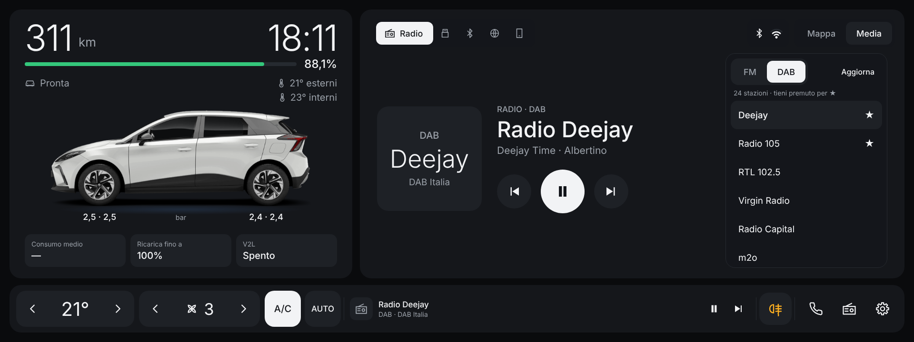
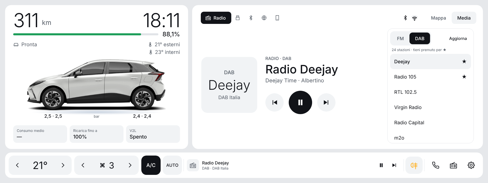

# MG4 Launcher — SWI69 Color Radio

🇮🇹 [Italiano](#italiano) · 🇬🇧 [English](#english)

**Ultima versione / Latest version: [0.2.4](releases/MG4Launcher-SWI69-0.2.4.apk)**

<a href="https://www.paypal.com/pool/9tv7fQ36nA?sr=wccr"></a>

> ⚠️ **Compatibilità / Compatibility:** solo infotainment **SWI69 Color Radio** · only **SWI69 Color Radio** infotainment.
> Garantita al momento su **MG4 standard MY23 R45**; usando i dati della FICM originale dovrebbe funzionare su tutte
> le versioni con **Color Radio** · Currently verified on **MG4 standard MY23 R45**; since it uses the original FICM's
> data it should work on every **Color Radio** version.
> Per **SWI68 SAIC 1.0+** usa [Mg4-Launcher-SWI68](https://github.com/ernestomicco2026-cell/Mg4-Launcher-SWI68) · for **SWI68 SAIC 1.0+** use [Mg4-Launcher-SWI68](https://github.com/ernestomicco2026-cell/Mg4-Launcher-SWI68).

> Progetto amatoriale e **non ufficiale**: non è affiliato né approvato da MG Motor o SAIC Motor.
> I nomi MG / MG4 servono solo a indicare l'auto compatibile (infotainment SWI69). Installalo e usalo a tuo rischio.
>
> Hobby project, **not official**: not affiliated with or endorsed by MG Motor or SAIC Motor.
> The MG / MG4 names only identify the compatible car (SWI69 infotainment). Install and use it at your own risk.

---



<sub>Anteprima della grafica 0.2.3 (tema notte e giorno, con decimali e pressione pneumatici attivi): i valori sono di esempio · Preview of the 0.2.3 design (night and day theme, decimals and tyre pressure on): values are examples.</sub>

---

## Sostieni il progetto / Support the project

MG4 Launcher è gratuito e lo resterà. Se ti è utile e ti va di contribuire alle ore passate a svilupparlo e a provarlo
in auto, puoi lasciare una piccola offerta libera. È del tutto **facoltativa**: grazie anche solo per usarlo e per
le segnalazioni.

MG4 Launcher is free and will stay free. If you find it useful and would like to support the hours spent building and
testing it in the car, you can leave a small donation of any amount. It is entirely **optional**: thank you just for
using it and reporting issues.

<a href="https://www.paypal.com/pool/9tv7fQ36nA?sr=wccr"></a>

## Quale versione installare? / Which version should I install?

Ci sono **due launcher diversi**, uno per ciascun software dell'infotainment MG4. Non sono intercambiabili:
servizi dell'auto, radio, media e clima sono diversi, e con la versione sbagliata il launcher si apre ma non legge
nulla dall'auto ("Servizio veicolo non disponibile").

| Software dell'auto | Repository | File APK |
|---|---|---|
| **SWI68 SAIC 1.0+** | [Mg4-Launcher-SWI68](https://github.com/ernestomicco2026-cell/Mg4-Launcher-SWI68) | `MG4Launcher-X.Y.Z.apk` |
| **SWI69 Color Radio** | **questo repository** | `MG4Launcher-SWI69-X.Y.Z.apk` |

**Come sapere quale software hai:** con il computer collegato all'auto
`adb shell getprop ro.build.mt2712.version` → se inizia con `SWI69-` è la **SWI69**, altrimenti (es. `SWI68-…`) è la **SWI68**.
Se il launcher è già installato: impostazioni → riga **MG4 Launcher X.Y.Z · repository** sotto *Aggiornamenti*;
il nome del repository dice quale versione hai. Se nella *Diagnostica* compaiono `veicolo.bind = fallito` e
`media.usb.bind = fallito`, hai installato la versione SWI68 su un'auto SWI69 (o viceversa).

There are **two different launchers**, one per MG4 infotainment software, and they are not interchangeable.
Check your software with `adb shell getprop ro.build.mt2712.version` (starts with `SWI69-` = SWI69, otherwise SWI68) and
use the matching repository above.

---

## Italiano

Launcher in stile Tesla per l'infotainment della **MG4** con software **SWI69 Color Radio**
(EH32, Android Automotive 9, build `SWI69-29958-1100R45`).

**Compatibilità:** funziona **solo con il software SWI69 Color Radio**. La SWI69 Color Radio non è un aggiornamento
della SWI68: è un software diverso, con altri servizi dell'auto. Su SWI68 usa la [versione SWI68](https://github.com/ernestomicco2026-cell/Mg4-Launcher-SWI68).
Sostituisce la schermata home originale mantenendone le funzioni, con la stessa grafica della versione SWI68.

**Versioni dell'auto:** al momento la compatibilità è **garantita sulla MG4 standard MY23 con software R45**
(`SWI69-29958-1100R45`), dove il launcher è stato provato. Dato che usa gli stessi dati e servizi della **FICM**
originale (l'unità dell'infotainment), dovrebbe funzionare su **tutte le versioni con la radio Color Radio**.
Se lo provi su un'altra versione, le segnalazioni sono benvenute: con l'invio dei log attivo arrivano da sole.

### Cosa fa

- **Auto e batteria** (a sinistra): autonomia e **orologio** grandi, barra batteria con la percentuale accanto e la
  tacca del limite di ricarica, stato di ricarica e V2L, temperatura esterna e interna; nelle impostazioni si attivano la percentuale
  con un decimale e la pressione degli pneumatici (TPMS) sotto le ruote. La tua MG4 ricolorabile con gli 8 colori della gamma, tetto nero opzionale.
  Tocca l'auto o V2L → app Energia. Tieni premuta l'auto → impostazioni del launcher.
- **Mappa / Media / CarPlay** (a destra):
  - **Mappa**: la SWI69 non ha un navigatore MG, si naviga con **CarPlay / Android Auto**. Senza guida una scheda
    mostra lo stato del telefono: collegato → pulsante **Apri CarPlay / Android Auto**; non collegato → ti ricorda
    di collegarlo. Durante la guida il pannello mostra le indicazioni del telefono.
  - **Media**: parte dalla sorgente in riproduzione, altrimenti dalla radio; in alto un pulsante per ogni sorgente
    (Radio, USB, Bluetooth, Online se disponibile, e CarPlay/Android Auto se il telefono è collegato);
    con più di 4 sorgenti quelle non selezionate mostrano solo l'icona.
    Per la radio: nome e logo della stazione, **preferiti** con i loghi e, a destra, **FM / DAB** con l'**elenco delle
    stazioni**: DAB dal servizio radio (**Aggiorna** per rileggerlo), FM dalla ricerca (**Cerca**) e dalle stazioni già
    ascoltate. Tocca una stazione per sintonizzarla, tienila premuta per aggiungerla o toglierla dai preferiti
    (★ = già tra i preferiti). Anche **tenendo premuto il riquadro della stazione** la aggiungi o la togli;
    tieni premuto un preferito per eliminarlo.
  - **CarPlay / Android Auto**: la scheda compare da sola quando colleghi il telefono.
  - In alto a destra, prima delle schede, una pillola con **Bluetooth** (pieno = telefono collegato, sbiadito = acceso)
    e **Wi-Fi** con 4 tacche di segnale (solo quando è collegato).
- **Barra in basso**, con comandi grandi da usare guidando: temperatura ‹ › (LO, 16…30, HI) e ventola ‹ ›
  (OFF / 1…11 / A = automatico; tocca il numero = app Clima, tieni premuto = accendi/spegni), pulsanti **A/C** e
  **AUTO** (acceso = colori invertiti), mini-player compatto, **retronebbia** (icona ambra da acceso) e
  **fendinebbia anteriori** (verde, solo se l'auto li ha), Telefono, Radio, Impostazioni.
- **App**: scorri la home verso sinistra per le app dell'auto e quelle che installi tu,
  con le icone tutte nello stesso stile; scorri verso destra per tornare. Con **Modifica** scegli quali app installate mostrare.
- **Impostazioni** (tieni premuta l'auto): colore dell'auto, tetto nero, tema (automatico, notte, giorno),
  **lingua**, aggiornamenti, diagnostica con **Salva log**.
  Si aprono anche dall'ingranaggio in alto a destra nella pagina App.
- **Lingue**: italiano, inglese, spagnolo, tedesco, portoghese, francese e turco. Con **Come l'auto** (predefinita)
  il launcher usa la lingua di sistema e si aggiorna da solo quando la cambi nell'auto; altrimenti scegli una lingua
  nelle impostazioni. Per le lingue non tradotte usa l'inglese.
- **Schermo intero**: barra di stato e dock MG nascosti (trascina dal bordo per richiamarli).
- **Aggiornamenti**: le nuove versioni si scaricano e si installano dalle impostazioni, senza computer. Quando ne
  esce una, compare in basso a destra un piccolo avviso con **Aggiorna** / **Più tardi** (sparisce da solo; "Più tardi"
  lo rimanda di un giorno).
- **Invio dei log**: il launcher invia in automatico la diagnostica allo sviluppatore
  (all'avvio, ogni 30 minuti e con **Salva log**), per poter correggere i problemi senza dover raccogliere i file a mano.
  Contiene solo versione, valori letti dai servizi dell'auto ed errori: niente posizione, telaio o dati del telefono.
  Si disattiva nelle impostazioni (**Invio log**).

### Installazione

Solo per infotainment **SWI69 Color Radio**. Scarica l'APK dalla cartella [`releases/`](releases/).
Ci sono due modi per installarlo: da chiavetta USB, se riesci ad aprire un file manager sull'auto, oppure con adb da computer.

#### Metodo 1 — Da chiavetta USB (senza computer)

Serve poter aprire un file manager sull'infotainment.

1. Copia `MG4Launcher-SWI69-0.2.4.apk` su una chiavetta USB formattata **FAT32** o **exFAT**.
2. Inserisci la chiavetta nell'auto, apri il file manager e tocca l'APK.
3. Se Android avvisa che non può installare app da questa fonte: tocca **Impostazioni**, attiva
   **Consenti da questa fonte** per il file manager e torna indietro.
4. Tocca **Installa**.
5. Premi il tasto **Home**: Android chiede quale home usare. Scegli **MG4 Launcher** e poi **Sempre**.

Se **Impostazioni** non apre nulla o l'installazione dà errore, usa il metodo 2
(e, se puoi, segnala il messaggio d'errore).

#### Metodo 2 — Con adb da computer

Serve un computer con [adb](https://developer.android.com/tools/releases/platform-tools) collegato all'auto.
Il firmware MG può bloccare l'installazione normale delle app: l'opzione `-f` la permette.

1. Installa:
   ```bash
   adb install -r -f MG4Launcher-SWI69-0.2.4.apk
   ```
2. Rendilo la home predefinita:
   ```bash
   adb shell cmd package set-home-activity com.mg4.launcher/.MainActivity
   ```
   In alternativa premi il tasto Home: Android chiede quale home usare.

Con entrambi i metodi il launcher parte poi da solo all'accensione dell'auto, come la home originale,
e gli aggiornamenti successivi si fanno dalle impostazioni del launcher, senza chiavetta né computer.

### Aggiornamenti

Impostazioni del launcher → **Aggiornamenti** → **Controlla aggiornamenti**.
Se c'è una versione più nuova compare **Scarica e installa**: il launcher la installa da solo e si riavvia.
Serve che l'auto sia collegata a internet (connettività dell'auto o hotspot del telefono).
Gli aggiornamenti arrivano solo da questo repository: una versione SWI68 non viene mai proposta.
Chi ha una versione precedente alla 0.1.3 deve installare una volta a mano una versione più recente (chiavetta o adb).
Si possono installare anche da computer, con lo stesso comando dell'installazione.

### Tornare alla home MG originale

Dal launcher: impostazioni → **Apri la home originale MG**. Per renderla di nuovo quella predefinita:

```bash
adb shell cmd package set-home-activity com.saicmotor.launcher/.view.MainActivity
```

Per rimuovere del tutto il launcher: `adb uninstall com.mg4.launcher`. L'app originale non viene mai modificata.

### Comandi utili

```bash
# riavviare il launcher senza spegnere l'auto
adb shell am force-stop com.mg4.launcher
adb shell am start -n com.mg4.launcher/.MainActivity

# vedere i valori letti dall'auto (Ctrl+C per fermare)
adb logcat -s MG4L MG4L.Link

# scaricare la diagnostica salvata dal launcher (aggiornata ogni 15 s)
adb pull /sdcard/Android/data/com.mg4.launcher/files/diagnostica.txt
```

### Segnalare un problema

Nelle impostazioni la colonna **Diagnostica servizi auto** mostra i valori letti dall'auto e gli errori recenti. Uno screenshot di quella colonna
o il file `diagnostica.txt` bastano per capire cosa succede.

Con **Salva log** (in alto nella colonna Diagnostica) il launcher scrive un log completo — valori, errori, eventi
recenti e logcat del launcher — in `Android/data/com.mg4.launcher/files/mg4-launcher-log-….txt`.
Se è inserita una chiavetta USB il file finisce anche lì, nella stessa cartella.


### Versioni

#### 0.2.4 — 14 ottobre 2026
- Temperatura interna nascosta quando l'auto non la fornisce (prima poteva comparire "0° interni").
- Pressione pneumatici: se il servizio dell'auto restituisce 0, il launcher prova a leggerla dal sistema auto di Android
  (con un nuovo permesso di sola lettura).

#### 0.2.3 — 14 ottobre 2026
- **Percentuale della batteria con un decimale** (es. 88,1%), attivabile nelle impostazioni.
- **Pressione degli pneumatici (TPMS)** sotto le ruote dell'auto disegnata (anteriori sotto la ruota davanti, posteriori
  sotto quella dietro, nell'unità scelta sul quadro; in ambra se l'auto segnala un problema), attivabile nelle impostazioni.
- **Temperatura interna** sotto quella esterna, quando l'auto la fornisce.

#### 0.2.2 — 13 ottobre 2026
- Nome corretto del software (**SWI69**) e del repository (**Mg4-Launcher-SWI69**). Se nelle impostazioni era salvato
  il vecchio repository Mg4-Launcher-SW169, il launcher passa da solo al nuovo per gli aggiornamenti.

#### 0.2.1 — 13 ottobre 2026
- Nome corretto del software: **SWI69** (non SW169) nel repository, nei file APK e nella cartella dei log.

#### 0.2.0 — 13 ottobre 2026
- **Orologio** nel riquadro batteria, grande quanto l'autonomia; percentuale accanto alla barra della batteria.
- **Clima più grande** e più facile da usare guidando: temperatura e ventola con pulsanti da 68 dp su fondo chip,
  nuovi pulsanti **A/C** e **AUTO**; barra in basso alta 100 dp e mini-player più compatto.
- **Fendinebbia**: retronebbia (e anteriori, se presenti) direttamente dalla barra in basso.
- **Indicatori Bluetooth e Wi-Fi** (4 tacche) in alto a destra.
- Con più di 4 sorgenti media, solo l'icona per quelle non selezionate.

#### 0.1.4 — 13 ottobre 2026
- **Invio automatico dei log** nel repository privato dello sviluppatore: all'avvio, ogni 30 minuti e con **Salva log**;
  senza rete restano in coda. Interruttore e stato nelle impostazioni (**Invio log**).
- **Avviso discreto di nuova versione**: piccola scheda in basso a destra con **Aggiorna** / **Più tardi**,
  controllo ogni 6 ore; sparisce da sola e "Più tardi" la rimanda di 24 ore.

#### 0.1.3 — 12 ottobre 2026
- Aggiornamenti più affidabili: niente più errore 403 durante il controllo.

#### 0.1.2 — 12 ottobre 2026
- Riquadro navigazione ridisegnato: scheda centrale con lo stato del telefono e pulsante per aprire CarPlay /
  Android Auto (o l'invito a collegare il telefono).
- Radio: elenco delle stazioni accanto ai comandi (DAB dal servizio radio, FM dalla ricerca e da quelle ascoltate),
  con FM / DAB in testa all'elenco, ★ per i preferiti, **Cerca** / **Aggiorna**; layout adattato allo schermo.
- **Multilingua**: italiano, inglese, spagnolo, tedesco, portoghese, francese e turco; scelta nelle impostazioni,
  con **Come l'auto** che segue la lingua di sistema.

#### 0.1.1 — 12 ottobre 2026
- Tolto il pulsante Telecamere: le MG4 con SWI69 non hanno la telecamera a 360°.
- Navigatore solo da CarPlay / Android Auto: tolti i pulsanti Casa / Lavoro, il pulsante "MG" e la scelta del
  navigatore predefinito nelle impostazioni; il launcher non si collega più al servizio di navigazione MG.

#### 0.1.0 — 12 ottobre 2026
- Prima versione per **SWI69 Color Radio**, con la grafica e le correzioni della versione SWI68 0.4.1.
- Servizi dell'auto riscritti per la SWI69: batteria, ricarica, V2L e clima dal servizio `caradapter`;
  limite di ricarica, potenza e consumo dal CarService (come l'app Energia).
- Clima **16–30 °C** (LO / HI agli estremi), come sulla MG4 EU con SWI69.
- Media con le sessioni standard di Android (USB, Bluetooth, online, radio); bande DAB / FM.
- Preferiti radio gestiti dal launcher (l'app Radio SWI69 non li rende leggibili alle altre app).
- V2L e auto aprono l'app Energia; pulsante Telecamere come la home originale SWI69.
- Pulsante "MG" del navigatore solo se l'auto ha un navigatore MG.
- Aggiornamenti solo da questo repository.

### Compilare

Il launcher si compila con lo script `build.sh` incluso, senza Gradle; alcuni strumenti Android necessari non sono
nel repository e vanno aggiunti in `tools/`. La versione è in `version.properties`, i testi delle 7 lingue in
`tools/strings.py`. Gli APK pubblicati sono nella cartella `releases/`.

### Come comunica con l'auto

Il launcher usa gli stessi servizi di sistema della home originale **SWI69 Color Radio**: veicolo e batteria, clima,
luci, media, radio e CarPlay / Android Auto. Legge i dati e invia all'auto solo i comandi che tocchi tu (clima,
fendinebbia, sorgenti e brani); non modifica nulla del sistema.

La mappa di CarPlay / Android Auto non può essere mostrata dentro il launcher:
il pannello Mappa mostra le indicazioni del telefono e apre CarPlay / Android Auto a schermo intero.

### Note

- L'immagine dell'auto deriva da una foto ufficiale MG; marchi e immagini appartengono ai rispettivi proprietari.
- I loghi delle stazioni FM vengono da [radio-browser.info](https://www.radio-browser.info), database pubblico e gratuito.

---

## English

Tesla-style launcher for the **MG4** infotainment system running **SWI69 Color Radio** software
(EH32, Android Automotive 9, build `SWI69-29958-1100R45`).

**Compatibility:** works **only with SWI69 Color Radio**. SWI69 Color Radio is not an update of SWI68: it is different
software with different car services. On SWI68 use the [SWI68 version](https://github.com/ernestomicco2026-cell/Mg4-Launcher-SWI68).
It replaces the original home screen, keeping its features, with the same design as the SWI68 version.

**Car versions:** compatibility is currently **verified on the MG4 standard MY23 with R45 software**
(`SWI69-29958-1100R45`). Since it uses the same data and services as the original **FICM** (the infotainment unit),
it should work on **every version with the Color Radio**. Reports from other versions are welcome.

### Features

- **Car and battery** (left): large range and **clock**, battery bar with the percentage next to it and a
  charge-limit mark, charging and V2L status, outside and inside temperature; the settings turn on the percentage with one
  decimal and the tyre pressure (TPMS) under the wheels. Your MG4, recolourable with the 8 factory colours, optional black roof.
  Tap the car or V2L → Energy app. Long-press the car → launcher settings.
- **Map / Media / CarPlay** (right):
  - **Map**: SWI69 has no MG navigator, navigation is done with **CarPlay / Android Auto**. When not guiding, a card
    shows the phone status with an **Open CarPlay / Android Auto** button (or a reminder to connect the phone);
    while guiding, the panel shows the phone's directions.
  - **Media**: starts on the source that is playing, otherwise the radio; one button per source at the top
    (Radio, USB, Bluetooth, Online when available, plus CarPlay/Android Auto when a phone is connected);
    with more than 4 sources the unselected ones show only their icon.
    Radio: station name and logo, **favourites** with logos and, on the right, **FM / DAB** with the **station list**
    (DAB from the radio service, FM from a scan and from stations you have listened to). Tap a station to tune in,
    long-press it to add/remove it from favourites (★). Long-pressing the station tile also adds/removes it.
  - **CarPlay / Android Auto**: the tab appears by itself when you connect a phone.
  - Top right, before the tabs, a pill with **Bluetooth** (solid = phone connected, faded = on) and **Wi-Fi** with
    4 signal bars (only when connected).
- **Bottom bar**, with large controls for use while driving: temperature ‹ › (LO, 16…30, HI) and fan ‹ ›
  (OFF / 1…11 / A = auto; tap the number = Climate app, long-press = climate on/off), **A/C** and **AUTO** buttons
  (on = inverted colours), compact mini player, **rear fog light** (amber icon when on) and **front fog lights**
  (green, only if fitted), Phone, Radio, Settings.
- **Apps**: swipe the home screen left for the car's apps and the ones you install; swipe right to go back.
  Use **Modifica** (Edit) to choose which installed apps to show.
- **Settings** (long-press the car): car colour, black roof, theme, **language**, updates,
  diagnostics with **Salva log** (save log). Also available from the gear at the top right of the Apps page.
- **Full screen**: status bar and MG dock hidden (swipe from the edge to bring them back).
- **Updates**: new versions download and install from the settings, no computer needed. When one is out, a small
  notice with **Update** / **Later** appears at the bottom right (it hides by itself; "Later" waits a day).
- **Log upload**: the launcher automatically sends its diagnostics to the developer (at start,
  every 30 minutes and with **Save log**). Only version, values read from the car services and errors: no location,
  VIN or phone data. It can be turned off in the settings (**Log upload**).

**Languages:** Italian, English, Spanish, German, Portuguese, French and Turkish. **Same as car** (default) follows
the system language and updates by itself when you change it in the car; or pick a language in the settings.
Other system languages fall back to English.

### Installation

Only for **SWI69 Color Radio** infotainment. Download the APK from the [`releases/`](releases/) folder.
There are two ways to install it: from a USB stick, if you can open a file manager on the car, or with adb from a computer.

#### Method 1 — From a USB stick (no computer)

You need to be able to open a file manager on the infotainment.

1. Copy `MG4Launcher-SWI69-0.2.4.apk` to a USB stick formatted as **FAT32** or **exFAT**.
2. Plug it into the car, open the file manager and tap the APK.
3. If Android says it cannot install apps from this source: tap **Settings**, enable
   **Allow from this source** for the file manager and go back.
4. Tap **Install**.
5. Press the **Home** button: Android asks which home app to use. Pick **MG4 Launcher**, then **Always**.

If **Settings** does nothing or the install fails, use method 2 (and, if you can, report the error message).

#### Method 2 — With adb from a computer

You need a computer with [adb](https://developer.android.com/tools/releases/platform-tools) connected to the car.
The MG firmware may block normal app installs; the `-f` option allows it.

1. Install it:
   ```bash
   adb install -r -f MG4Launcher-SWI69-0.2.4.apk
   ```
2. Make it the default home:
   ```bash
   adb shell cmd package set-home-activity com.mg4.launcher/.MainActivity
   ```
   Or press the Home button: Android asks which home app to use.

Either way, the launcher then starts by itself when the car switches on, like the original home,
and later updates are installed from the launcher settings, with no USB stick or computer.

### Updates

Launcher settings → **Aggiornamenti** (Updates) → **Controlla aggiornamenti** (Check for updates).
If a newer version exists, **Scarica e installa** (Download and install) appears: the launcher installs it and restarts.
The car needs an internet connection (car connectivity or phone hotspot). Updates come only from this repository:
a SWI68 build is never offered. Anyone on a version older than 0.1.3 must install a newer one once by hand
(USB stick or adb).

### Going back to the original MG home

From the launcher: settings → **Apri la home originale MG**. To make it the default again:

```bash
adb shell cmd package set-home-activity com.saicmotor.launcher/.view.MainActivity
```

To remove the launcher completely: `adb uninstall com.mg4.launcher`. The original app is never modified.

### Reporting a problem

Settings → **Diagnostica servizi auto** shows the raw values read from each car service and recent errors;
**Salva log** writes a full log to `Android/data/com.mg4.launcher/files/`: it is the quickest way to fix anything
that does not work.

### Changelog

#### 0.2.4 — 14 October 2026
- Inside temperature hidden when the car does not provide it (it could show "0° inside").
- Tyre pressure: if the car service returns 0, the launcher tries the Android car system properties
  (with a new read-only permission).

#### 0.2.3 — 14 October 2026
- **Battery percentage with one decimal** (e.g. 88.1%), can be turned on in the settings.
- **Tyre pressure (TPMS)** under the wheels of the car picture (front under the front wheel, rear under the rear one, in the
  unit chosen on the cluster; amber when the car reports a problem), can be turned on in the settings.
- **Inside temperature** under the outside one, when the car provides it.

#### 0.2.2 — 13 October 2026
- Correct software name (**SWI69**) and repository name (**Mg4-Launcher-SWI69**). If the old Mg4-Launcher-SW169
  repository was saved in the settings, the launcher switches to the new one for updates by itself.

#### 0.2.1 — 13 October 2026
- Correct software name: **SWI69** (not SW169) in the repository, APK files and log folder.

#### 0.2.0 — 13 October 2026
- **Clock** in the battery panel, as large as the range; percentage next to the battery bar.
- **Larger climate controls** for use while driving: temperature and fan with 68 dp buttons on a chip background,
  new **A/C** and **AUTO** buttons; 100 dp bottom bar and a more compact mini player.
- **Fog lights**: rear (and front, if fitted) straight from the bottom bar.
- **Bluetooth and Wi-Fi indicators** (4 bars) at the top right.
- With more than 4 media sources, only the icon for the unselected ones.

#### 0.1.4 — 13 October 2026
- **Automatic log upload** to the developer's private repository (at start, every 30 minutes, with Save log; queued
  when offline), with a switch and status in the settings.
- **Discreet new-version notice** at the bottom right with Update / Later, checked every 6 hours.

#### 0.1.3 — 12 October 2026
- More reliable updates: no more 403 error while checking.

#### 0.1.2 — 12 October 2026
- Redesigned navigation card with phone status and an Open CarPlay / Android Auto button.
- Radio: station list next to the controls (DAB from the radio service, FM from scan and listened stations),
  FM / DAB on top of the list, ★ for favourites, Scan / Refresh; layout adapted to the screen.
- **Multilingual**: Italian, English, Spanish, German, Portuguese, French, Turkish; chosen in the settings, with
  **Same as car** following the system language.

#### 0.1.1 — 12 October 2026
- Cameras button removed: MG4 cars with SWI69 have no 360° camera.
- Navigation only through CarPlay / Android Auto: Home / Work buttons, the "MG" button and the default-navigator
  setting removed; the launcher no longer connects to the MG navigation service.

#### 0.1.0 — 12 October 2026
- First version for **SWI69 Color Radio**, with the design and fixes of SWI68 version 0.4.1.
- Car services rewritten for SWI69 (`caradapter` hub, CarService `bms` properties, standard Android media sessions).
- Climate range **16–30 °C**; radio favourites kept by the launcher; V2L and the car open the Energy app;
  Cameras button like the original SWI69 home; MG navigator button only when present; updates only from this repository.
